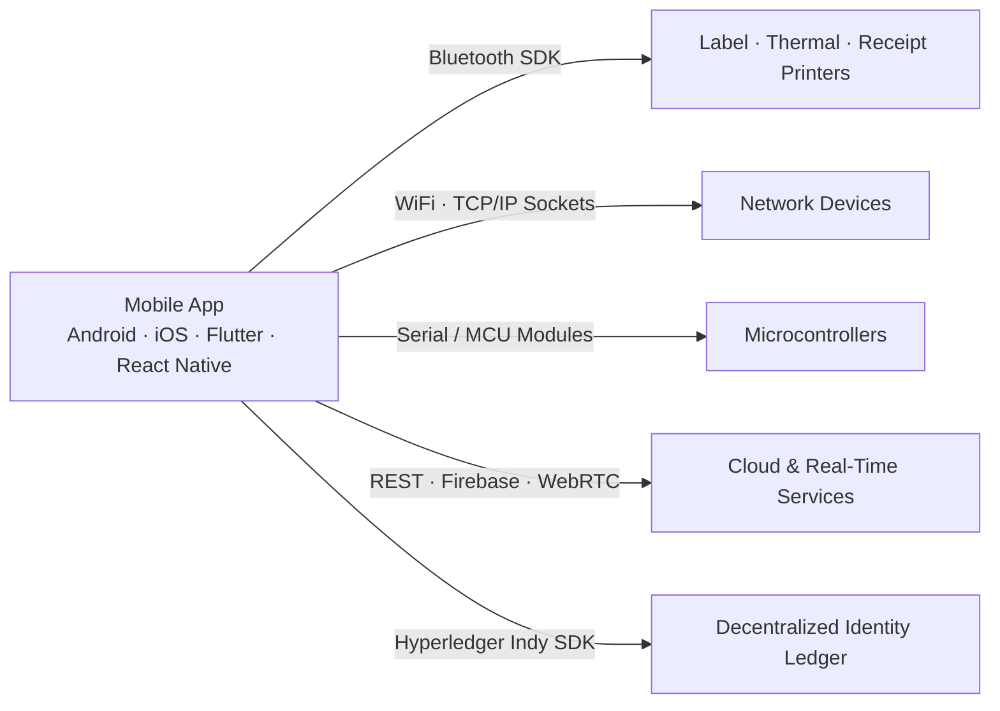

  

  
  

---

## Profile

I build mobile software that **talks to the real world**: printers over Bluetooth, devices over WiFi sockets, microcontrollers, and decentralized identity ledgers. B.Sc. in Computer Science & Engineering, with production work across **fintech, healthcare, and enterprise printing**, and a research background in **CNN-based data extraction**.

| | |
|---|---|
| **Current role** | Software Engineer, Nazihar Group (Dec 2025 to present) |
| **Leadership** | Led a mobile development team at Astha Insight |
| **Platforms** | Android · iOS · Flutter · React Native · Windows & macOS (desktop) |
| **Shipped** | Multiple apps live on Google Play |
| **Languages** | Bengali (native) · English (C2) |

---

## Systems I Build

---

## Toolbox

  

| Domain | Focus |
|---|---|
| **Native Mobile** | Android (Java) · iOS (Swift) |
| **Cross-Platform** | Flutter / Dart · React Native |
| **Connectivity & Hardware** | Bluetooth SDK · WiFi / TCP-IP · Socket Programming · MCU Integration |
| **Blockchain** | Hyperledger Indy · DApps · Smart Contract Interaction · Key Management |
| **Integration** | REST APIs · Firebase · WebRTC · Google Maps SDK · Payment Gateways |
| **AI / ML** | CNN · OCR · Facial Recognition |
| **Practice** | System Architecture · UI/UX Design · Git & CI/CD · Code Review · Mentoring |

---

## Career

| Period | Role | Highlights |
|---|---|---|
| **Dec 2025 – Present** | Software Engineer *Nazihar Group, Dhaka* | React Native blockchain wallet · Hyperledger Indy identity & verifiable credentials · end-to-end wallet encryption |
| **Dec 2024 – Sep 2025** | Software Engineer, Team Lead *Astha Insight, Rajshahi* | Led mobile team · Flutter + Firebase + WebRTC architecture · real-time blood donation platform with maps and push alerts |
| **Feb 2023 – Nov 2024** | Software Engineer *THT-Space Electrical Company Ltd, Nilphamari* | Bluetooth printing SDKs (Java & Swift) · TCP/IP and background WiFi transfer · OCR attendance-card SDK |

---

## Featured Work

<table>
<tr>
<td width="50%" valign="top">

### 12iD: Blockchain Wallet
Decentralized wallet to store, send, and receive money and digital assets, with a tamper-proof transaction ledger, private key management, and DeFi integration.

`React Native` `Hyperledger Indy` `Cryptography`

[Google Play](https://play.google.com/store/apps/details?id=com.onetwoid.mobile)

</td>
<td width="50%" valign="top">

### Grozziie: Printing & Attendance
Bluetooth printing for label, thermal, receipt, and dot-matrix printers, with M880 attendance machine integration for payroll and overtime. Web dashboard and desktop tools included.

`Bluetooth` `Android · iOS · Windows · macOS`

[Google Play](https://play.google.com/store/apps/details?id=com.grozziie.printer)

</td>
</tr>
<tr>
<td width="50%" valign="top">

### BanglaBridge *(In Development)*
Cross-platform community app for the global Bangladeshi diaspora: social networking, news, event notifications, and discussion forums.

`Real-Time` `Community`

</td>
<td width="50%" valign="top">

### AI Class Monitoring System
Computer vision and facial recognition for automated attendance and engagement detection, with ML analytics on participation and performance. **Best Project Award.**

`Computer Vision` `ML Analytics`

</td>
</tr>
</table>

---

## Recognition & Education

- **1st Place**, Inter-University Programming Contest (Feb 2022)
- **Best Project Award**, AI/ML Project Showcase Contest (Feb 2022)
- **B.Sc. in Computer Science & Engineering**, Pundra University of Science & Technology (2022)

---

  <b>Open to conversations about mobile architecture, IoT connectivity, and decentralized identity.</b> 
  Off the keyboard: cycling, AI, and machine learning.

